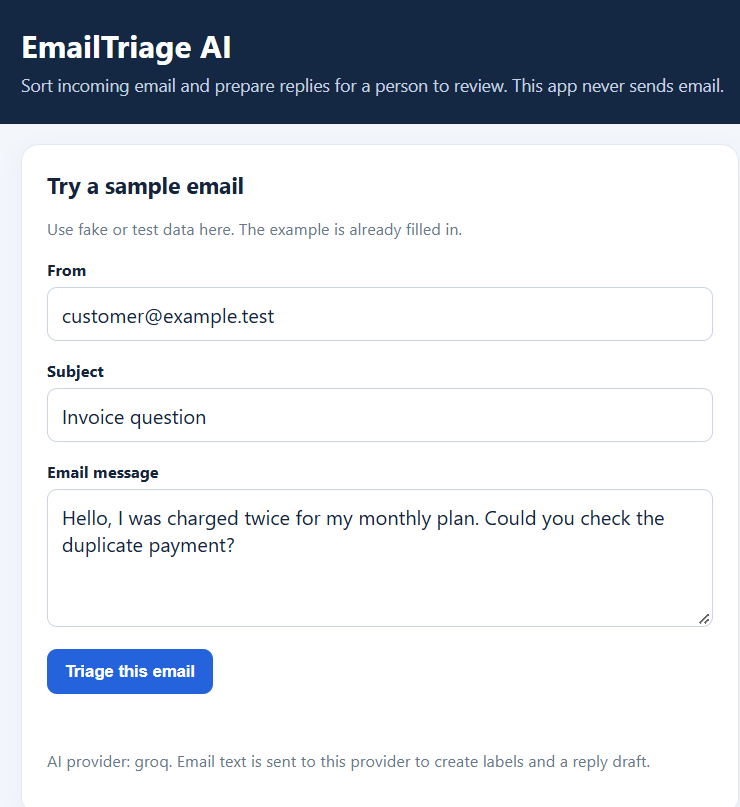
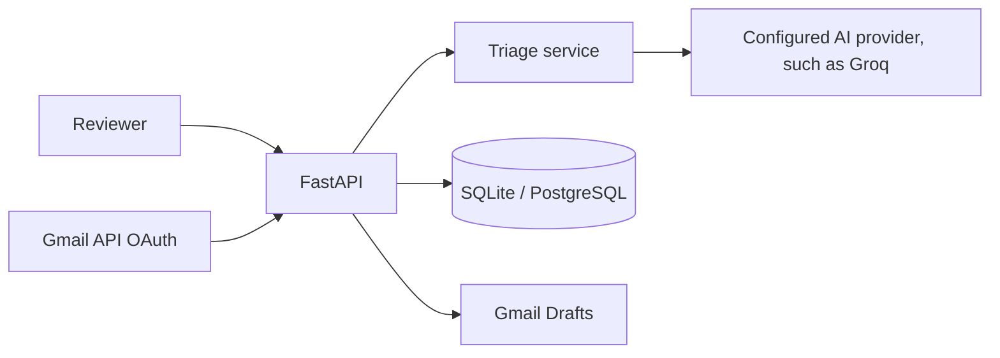

# EmailTriage AI

Python + FastAPI app that classifies test-labeled Gmail messages, summarizes them, and prepares reply drafts for a person to review. The app has no send endpoint; its Gmail integration reads messages labeled `EmailTriage-Test` and saves drafts in Gmail.

> **Demo video:** [Watch on Google Drive](https://drive.google.com/file/d/1leMDRpwrMjhFTCtxieIn1VFXubQxw36c/view?usp=sharing) (61 seconds)

## Screenshot



## For

Small teams that need a first pass over support, billing, sales, meeting, and other inbox messages.

## Features

- Classifies messages and marks likely urgent messages.
- Produces a short summary and editable reply draft.
- Stores messages in PostgreSQL for the assignment stack; SQLite is available for a quick local-only demo.
- Gmail OAuth integration to import only messages labeled `EmailTriage-Test` and save reviewed drafts.
- Gmail message and thread IDs are retained so reply drafts can attach to the original conversation when Gmail provides threading metadata.
- Edited replies update their existing Gmail draft in place instead of creating another copy.
- Configurable AI provider: Gemini (free-tier option), Groq, OpenRouter, OpenAI, or Claude, plus a local rule-based demo mode.
- Simple browser inbox for adding emails, reviewing/editing saved drafts, and refreshing the inbox. It opens on synthetic `example.test` samples; filters separate app-added messages, Gmail imports, and all messages.
- Inbox overview cards update with the selected filter to show total messages, high-priority items, and Gmail drafts saved.
- Branded Swagger API docs at `/docs`, grouped by System, Email triage, and Gmail; health endpoint, validation, duplicate sync protection, and retry-friendly errors.
- Sending is intentionally absent: the human reviews and sends from Gmail.

## Tools used

- FastAPI and SQLAlchemy for the Python app and database access.
- PostgreSQL for the assignment setup; local SQLite is optional for a quick demo.
- Groq free tier used as the AI provider (`AI_PROVIDER=groq`); Gemini, OpenRouter, OpenAI, and Claude adapters are also configurable via `AI_PROVIDER` in `.env`.
- Gmail API OAuth uses read-only access and the compose scope. The app code only creates drafts and exposes no send endpoint; Google's compose scope itself is broader and can permit sending, so authorize only your own test account.
- Docker Compose runs PostgreSQL locally. A container `Dockerfile` is included for deployment hosts.

## Architecture



## Run locally

Requires Python 3.11+.

```powershell
py -3.11 -m venv .venv
.venv\Scripts\Activate.ps1
python -m pip install -r requirements.txt
Copy-Item .env.example .env
docker compose up -d db
uvicorn app.main:app --reload
```

Open `http://127.0.0.1:8000/` for the simple inbox. For the developer API docs, open `/docs`. To preload sample emails in another terminal:

```powershell
python -m app.demo
```

Then use the browser inbox to inspect classifications and edit saved reply drafts. The starter `.env.example` selects `AI_PROVIDER=local`, which runs a deterministic demo fallback without sending email content to an AI service. To try a free provider, create a Gemini API key in Google AI Studio and set these values in your private `.env`:

```dotenv
AI_PROVIDER=gemini
GEMINI_API_KEY=your_private_key_here
GEMINI_MODEL=gemini-3.8-flash
```

Install updated dependencies with `python -m pip install -r requirements.txt`, then restart the app. The code also supports Groq, OpenRouter, OpenAI, and Claude; choose the matching `AI_PROVIDER` and set its corresponding key/model variables from `.env.example`. The Gemini API call uses `store=False`. Regardless of provider, use sample/test email content until you review its data handling settings.

## Gmail setup

1. Create a Google Cloud project and enable the Gmail API.
2. Configure the OAuth consent screen and create a **Desktop app** OAuth client for a test account.
3. Download the client JSON into the project root as `credentials.json` (never commit it).
4. In your test Gmail account, create a label named `EmailTriage-Test` and apply it only to a fake/test email. Start the app, then call `POST /api/gmail/sync` in `/docs`. It imports only messages carrying this label. On first use, complete Google's local OAuth consent flow.
5. Review a message and edit its draft with `PATCH /api/emails/{id}/draft`. Call `POST /api/emails/{id}/gmail-draft` to save it in Gmail Drafts.

The app requests read-only plus compose scopes. Its code saves drafts only and has no send endpoint, but the compose scope can also permit sending. Authorize only your own test account and use synthetic emails.

## PostgreSQL

The provided `docker-compose.yml` starts a local PostgreSQL 16 database for development. Start Docker Desktop, then run `docker compose up -d db` from the project folder. Keep the `.env.example` PostgreSQL URL for the local container. To stop it later, run `docker compose down` (your database data remains in its local volume). For deployment, set `DATABASE_URL` to the managed PostgreSQL connection string in the host's private environment settings. Never commit production credentials.

For a quick demo without Docker, change `DATABASE_URL` in your private `.env` to `sqlite:///./emailtriage.db`; this mode is only for local development. The app also accepts PostgreSQL through `DATABASE_URL`.

On startup, the app creates its tables and adds nullable Gmail metadata columns to an existing local database when needed.

## API

- `GET /health`
- `POST /api/emails` — classify a supplied email
- `GET /api/emails?category=support` — list/filter
- `GET /api/emails/{id}`
- `PATCH /api/emails/{id}/draft` — edit draft
- `POST /api/gmail/sync` — import up to configured limit
- `POST /api/emails/{id}/gmail-draft` — save or update the app's reply in Gmail Drafts, does not send (works for manually added emails and Gmail-synced messages)

## Environment variables

See `.env.example`. Never commit `.env`, OAuth credentials, or token files. The selected AI provider receives the email text for classification and draft generation; use sample/test inbox data until you have reviewed the provider's data handling settings.

## Main-flow checklist

- [x] Health endpoint reports `ok` (manual check: HTTP 200).
- [x] Empty email body is rejected with HTTP 422.
- [x] Billing sample email classified as billing; Groq provider reported active.
- [x] Sample email persisted and appeared in inbox review (manual API checks: create HTTP 201, list HTTP 200).
- [x] Draft can be edited and updated draft appears on detail.
- [x] Unknown email ID returns HTTP 404.
- [x] Gmail sync imported the labeled fake test email.
- [x] Gmail draft appeared in Drafts; no message was sent.
- [x] Saving twice updates one Gmail draft rather than creating duplicates.
- [x] Second Gmail sync reported 0 new emails; existing test email was not duplicated.
- [x] Invalid OAuth/API configuration returns a safe retryable error.

## Deployment

The included `render.yaml` is a Render Blueprint for a temporary review demo. After the repository is available on GitHub, connect it to Render as a Blueprint and provide `GROQ_API_KEY` in Render's private environment settings. Never commit `.env`, OAuth client files, OAuth tokens, or provider keys.

The hosted demo uses synthetic emails and PostgreSQL. Gmail OAuth is disabled in the public demo because the current Google OAuth client is a Desktop client, not a web-server client. Render's free web service can sleep when idle, and its free Postgres database expires after 30 days; use it as a temporary review demo, not for permanent storage.

## License

Internship exercise starter. Add a license only if your reviewer requests one.
